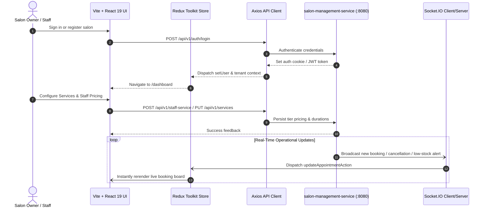

# ZenMonk Salon Management Web App (`salon-management-app`)

A responsive, feature-rich web portal built for salon owners, managers, and staff to run their day-to-day salon operations, manage appointment bookings, track inventory, customize their storefront appearance, and configure staff service pricing.

---

## 1. Problem Statement

Salon owners face significant overhead orchestrating multiple business dimensions without an integrated platform:
- **Scheduling Conflicts & Walk-in Chaos:** Paper-based or disconnected calendars lead to double bookings, unassigned specialists, and inefficient service bays.
- **Dynamic Pricing & Specialist Tiers:** Different stylists (e.g. Senior Stylist vs. Apprentice) command different service durations and fees, which is cumbersome to configure manually.
- **Stock Depletion & Wastage:** Stock items used in treatments or sold over the counter go untracked until shortages occur.
- **Branding & Storefront Presence:** Salon owners want a branded customer-facing storefront without hiring web developers.

**`salon-management-app`** solves these operational hurdles by providing an intuitive single-pane management dashboard with real-time booking management, visual slot schedulers, customizable salon themes, inventory transaction logs, staff onboarding, and Stripe subscription billing.

---

## 2. High-Level Functional Architecture & Data Flow



---

## 3. Tech Stack

- **Framework:** React 19 + Vite
- **Language:** TypeScript
- **State Management:** Redux Toolkit (`@reduxjs/toolkit`, `react-redux`)
- **Styling:** Tailwind CSS v4 + Base UI (`@base-ui/react`)
- **Forms & Validation:** React Hook Form + Zod / Resolvers
- **Payments:** Stripe Elements (`@stripe/react-stripe-js`, `@stripe/stripe-js`)
- **Icons & Visualization:** Lucide React, TanStack Virtual (for virtualized lists)
- **HTTP & Real-Time:** Axios, Socket.IO Client

---

## 4. Setup & Running the Application

### Prerequisites
- Node.js (>= 18.x) and npm (for local runs)
- Docker & Docker Compose (for Docker runs)
- Shared Docker network created (for Docker setups):
  ```bash
  docker network create salon_management_shared_network 2>/dev/null || true
  ```
- Backend service `salon-management-service` accessible on `http://localhost:8080`

### Environment Configuration
Create or update your `.env` file:
```bash
cp .env.example .env
```
Key configuration parameters:
```env
PORT=3000
APP_FORWARD_PORT=3000
VITE_BACKEND_URL=http://localhost:8080
VITE_STOREFRONT_URL=http://localhost:3001
VITE_STOREFRONT_DOMAIN=salon.com
VITE_MAPBOX_BASE_URL=https://api.mapbox.com/geocoding/v5/mapbox.places
VITE_MAPBOX_ACCESS_TOKEN=<your-mapbox-token>
VITE_STRIPE_PUBLISHABLE_KEY=<your-stripe-publishable-key>
VITE_CLOUDINARY_FOLDER=admin
VITE_MAX_STAFF_DOCS_LIMIT=10
VITE_APP_NAME=Veloura
```

---

### Running with Docker

#### A. Development Mode (via Docker Compose)
The project includes a `Dockerfile.dev` and `docker-compose.yml` for containerized development with live source-code mounting:

```bash
# 1. Start the development container in the background
docker compose up -d --build

# 2. Run the Vite development server inside the running container
docker compose exec app npm run dev -- --host 0.0.0.0 --port 3000

# 3. Check container logs
docker compose logs -f app

# 4. Stop container
docker compose down
```

#### B. Production Mode (Multi-Stage Nginx Build)
The production `Dockerfile` compiles the TypeScript assets and serves the static build using an optimized Nginx container:

```bash
# 1. Build the production image
docker build -t salon-management-app:prod .

# 2. Run the production container on port 3000
docker run -d \
  --name salon-management-app-prod \
  --network salon_management_shared_network \
  -p 3000:80 \
  salon-management-app:prod

# 3. View Nginx access logs
docker logs -f salon-management-app-prod

# 4. Stop and remove container
docker stop salon-management-app-prod && docker rm salon-management-app-prod
```

---

### Running Locally on Host Machine

#### A. Development Mode
```bash
# Install dependencies
npm install

# Start Vite dev server with Hot Module Replacement (HMR)
npm run dev
```
Access the application at `http://localhost:3000`.

#### B. Production Build & Preview
```bash
# Typecheck and produce static bundle in /dist
npm run build

# Preview production build locally
npm run preview -- --port 3000
```
